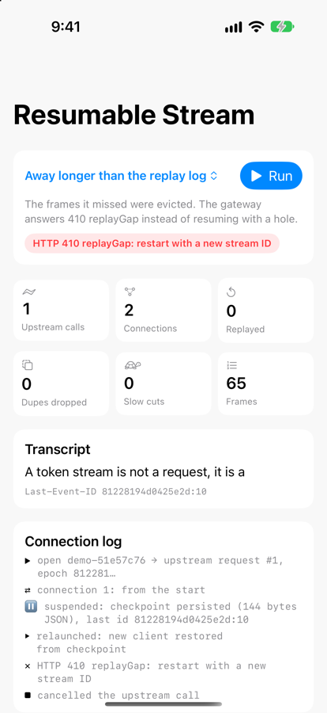
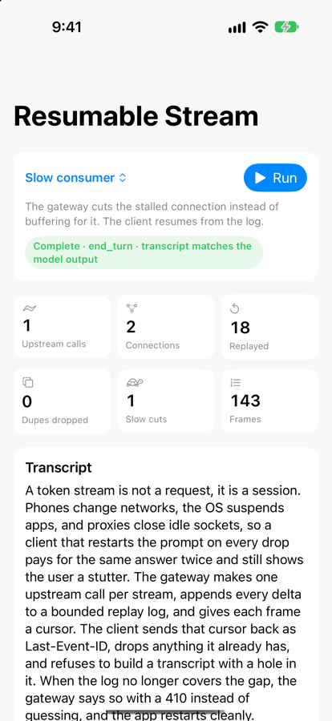
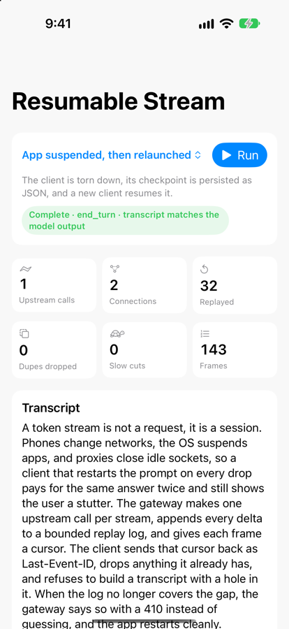
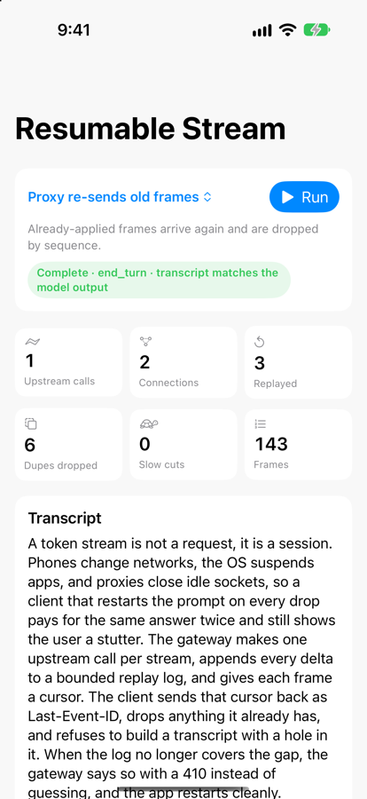
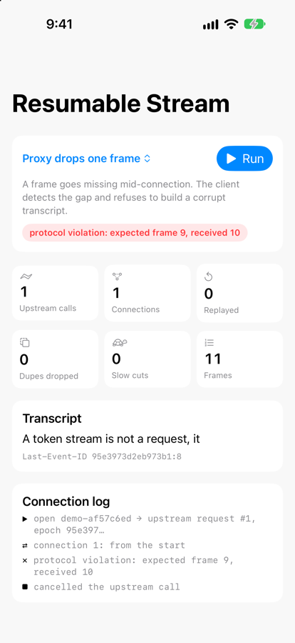

# StreamGateway Demo

**Break the network six different ways and watch one LLM answer arrive intact, paid for once.**

This is the iOS demo app for [StreamGateway](https://github.com/rajatslakhina/resumable-stream-gateway-kit), a resumable token-streaming gateway and client. The app runs a real `StreamGateway` actor and a real `ResumableStreamClient` in-process. They talk over actual Server-Sent Events bytes, split into awkward chunks, through a transport that injects faults on cue. The counters on screen come from the gateway's own `stats()` (upstream calls, replayed, slow cuts, frames), the client's checkpoint (duplicates dropped, Last-Event-ID) and the transport's connection count.

It consumes the library as a **remote Swift package**, pinned to a release: `Demo.xcodeproj` has an `XCRemoteSwiftPackageReference` to `https://github.com/rajatslakhina/resumable-stream-gateway-kit.git` with `upToNextMajorVersion` from `1.0.0`, and the committed `Package.resolved` records the exact revision it resolved (`1.0.0` → `7911097`). There is no local path and no branch tracking.

## Why this matters

Most streaming chat UIs re-send the prompt when the connection drops. That bills the generation again and shows the user a *different* answer, because sampling isn't deterministic. The scenarios below are the failures a phone actually sees: a network handover, the OS suspending the app, a connection that stops draining, a proxy that replays or loses data. The demo shows what the resumable design does in each one, including the two cases where the right answer is to fail loudly instead of guessing.

## What you see

| Scenario | Fault injected | What should happen |
|---|---|---|
| **Connection drops twice** (default, runs on launch) | connection 1 dies after 14 frames, connection 2 after 21 | Two resumes with `Last-Event-ID`. **1 upstream call.** The transcript matches the model output exactly. |
| **App suspended, then relaunched** | the client is torn down after 10 deltas; its checkpoint is encoded to JSON; 1.5 s later a *new* client is built from the decoded checkpoint | The new client resumes the same generation. The gateway kept generating meanwhile and replays the backlog. |
| **Slow consumer** | the host side of connection 1 stops reading from the gateway for 0.9 s (a blocked socket write), with a live queue limit of 6 | The gateway cuts the stalled connection instead of buffering for it. One resume catches up from the shared log. |
| **Proxy re-sends old frames** | after a drop, the next connection first re-sends 6 frames the client already applied | 6 duplicates are dropped by sequence number. Transcript unchanged. |
| **Away longer than the replay log** | 2.5 s suspension against a 12-frame replay log | The gateway answers **410 replayGap**. The app is told to restart with a new stream ID, not handed a transcript with a hole, and it cancels the upstream call. |
| **Proxy drops one frame** | frame 9 silently disappears mid-connection | The client sees frame 10 where it expected 9 and stops with a protocol violation. Nothing after the hole is applied, and the app cancels the upstream call. |

Pick a scenario from the menu and tap **Run**. Launch arguments select a scenario directly (used for the screenshots): `-scenario dropMidStream | suspendAndRelaunch | slowConsumer | duplicateDelivery | replayGap | brokenProxy`.

## Screenshots

Captured with `xcrun simctl io … screenshot` from the unmodified project, resolving `StreamGateway` 1.0.0 from GitHub, running on an iPhone 18 Pro Simulator (iOS 27.2). The app was launched once per scenario with `-scenario <name>` and left to finish (about 10 s each). The status bar was set to 9:41 with `simctl status_bar`. Images are resized to 900 px tall.

Top row: the default scenario, the 410 case, and the backpressure cut. Bottom row: relaunch from a persisted checkpoint, de-duplication, and gap detection. The numbers vary a little between runs because the backoff delay is jittered and the upstream keeps generating while the client reconnects; the invariants (1 upstream call, transcript matches, or an explicit failure) do not.

## How to run it

1. `git clone https://github.com/rajatslakhina/resumable-stream-gateway-demo-app.git`
2. Open `Demo.xcodeproj` in Xcode 16 or later. Xcode resolves `StreamGateway` from GitHub at the pinned version.
3. Select the **Demo** scheme and any iOS 17+ Simulator.
4. Build and Run. The default scenario starts by itself.

## Design decisions

- **The gateway runs in-process, not behind a local HTTP server.** The point of the demo is the protocol and the failure handling, and an in-process `StreamGateway` plus `InMemoryTransport` exercises the same code a server would, including real SSE bytes split at arbitrary byte offsets mid-line, with faults that land at an exact frame. *Rejected:* a bundled Vapor server or a mock `URLProtocol`. The first needs a second process and can't run on a device; the second fakes the bytes and the timing, which is exactly what the parser and resume logic need to be tested against. The cost: the app never touches a socket, so `URLSessionStreamTransport` is not exercised here (the library README says so too).
- **The lab UI lives in the library's `StreamGatewayUI` product, and the app target is a thin shell.** The app owns the configuration (script, token pace, gateway limits) and the scene. Keeping the view and view model in the package means they are compiled by the package's CI on every library change and resolved through the same pinned remote dependency as the core. *Rejected:* putting the lab in the app target, which would leave its Swift 6 concurrency code unbuilt by the library's CI and untouched by the version pin.
- **Faults are scripted per scenario, not random.** Each scenario drops, stalls, replays or skips at a fixed frame, so the screen tells the same story every run and each screenshot can be checked against the README. *Rejected:* a random chaos mode; it looks impressive and can't be reasoned about. Timing still varies a little (jittered backoff, an upstream that keeps generating during reconnects), so counts like "Replayed" move by a few between runs. The invariants don't.
- **Scenarios are selectable by launch argument.** `-scenario <name>` makes every state reachable from `simctl launch`, so the screenshots were captured from the real app without UI automation.
- **A new tap of Run supersedes the old run.** Each run carries a generation number. A superseded run re-checks it after every `await` before writing to the screen, so it can't touch the new run's state, and it cancels its own upstream call.

## How it is put together

- `Demo/DemoApp.swift` is the whole app target. It owns `DemoConfiguration`: the scripted "model output" (142 tokens at 45 ms each, about 6.4 seconds of streaming; 143 frames with the terminal one) and the `GatewayConfiguration` limits each scenario starts from. That is why it imports the core `StreamGateway` module as well as `StreamGatewayUI`.
- `StreamLabView` and `StreamLabModel` (in the library's `StreamGatewayUI` product) run the scenario: open a stream on a fresh gateway with a `ScriptedUpstream`, connect a `ResumableStreamClient` through `InMemoryTransport` with that scenario's faults, and render the client events and gateway counters.
- The model's tokens are produced by `ScriptedUpstream`, not Claude, so the demo is deterministic and needs no API key. The README of the library shows where a real `ClaudeUpstream` plugs in.

## Verification

Three separate facts, stated separately:

**It ran on a Simulator, built from the published package.** After the kit was published, the unmodified project resolved `StreamGateway` from GitHub at `1.0.0` (revision `7911097`, the one in the committed `Package.resolved`), built with Xcode 27.2, and was installed on a dedicated "StreamGateway Demo iPhone 18 Pro" Simulator (iOS 27.2). It was launched once per scenario with `xcrun simctl launch … -scenario <name>`, the process was confirmed still running about 10 s after each launch, and the six screenshots above come from those runs. (Before publishing, the same six scenarios were also run against a local checkout of the kit; those screenshots have been replaced.)

**Not exercised by hand:** the Run button and the scenario menu were never tapped. Every screenshot comes from a launch-argument start. The "Run supersedes the previous run" guard was fixed after review and is verified by reading the code, not by tapping.

**CI builds it against the published package.** The workflow resolves `StreamGateway` from GitHub at the pinned version and builds the app for a generic iOS Simulator destination (`generic/platform=iOS Simulator`, so it doesn't depend on which simulator runtimes the runner has). The result for every commit and tag is on the repository's [Actions tab](https://github.com/rajatslakhina/resumable-stream-gateway-demo-app/actions).

## License

MIT
